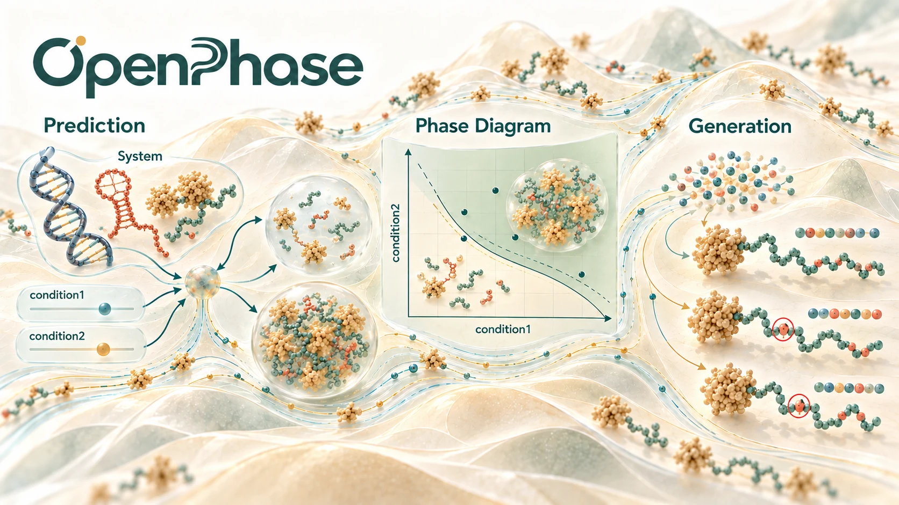

<p align="center">
  <a href="https://nicetone9.github.io/OpenPhase/"></a>
</p>

<p align="center">
  <b><a href="https://nicetone9.github.io/OpenPhase/">Open the OpenPhase site</a></b> &nbsp;·&nbsp;
  <a href="https://nicetone9.github.io/OpenPhase/records_space/">Records and protein universe (P)</a> &nbsp;·&nbsp;
  <a href="https://nicetone9.github.io/OpenPhase/records_space/negatives/">Negatives and unlabelled (N + U)</a>
</p>

# OpenPhase

OpenPhase: Condition-Aware Exploration of Biomolecular Phase Separation
OpenPhase is an open-source platform and dataset designed to accelerate knowledge discovery in Liquid-Liquid Phase Separation (LLPS). It is the first condition-aware platform for system-level exploration of how environmental factors influence biomolecular phase behavior.   

## 🌐 Interactive site

**[nicetone9.github.io/OpenPhase](https://nicetone9.github.io/OpenPhase/)** is the home page of the OpenPhase data resources. Click a part of the system figures to open the explorer on that system; every page has a light / dark switch and runs entirely in the browser.

| System | What it holds | Page |
|---|---|---|
| **P** | 11,439 single-protein experiment records in one map, plus 6,338 proteins that the tools list as positives but that have no record (hollow rings) | [records_space/](https://nicetone9.github.io/OpenPhase/records_space/) |
| **N + U** | 35,107 proteins: the training negatives of ten tools and PPMC against a Swiss-Prot reference sample. No positives, no conditions | [records_space/negatives/](https://nicetone9.github.io/OpenPhase/records_space/negatives/) |

Multi-protein systems (protein(2), protein(3), complexes) are shown on the home page but are not in the explorer yet. Details, data notes and licences: [`records_space/README.md`](records_space/README.md).

## 🚀 Key Features

### Condition-Aware Modeling
Moves beyond simple sequence prediction to incorporate extrinsic environmental factors (salt concentration, temperature, pH, etc.) that critically influence phase separation behavior.

### Comprehensive Datasets

- **db1**: Processed LLPSDBv2 data containing proteins, RNA, and DNA sequences with phase separation annotations
- **db2**: Manually collected records from laboratory notebooks covering both in vitro and in vivo experiments
- **db3**: Preprocessed RNAPSEC data focused on protein-RNA interaction systems and their phase behavior

### Standardized Benchmarking
Formalized tasks and evaluation protocols for:
- Outcome prediction
- Condition inference
- Protein design
- Reproducible research in LLPS

## 🛠️ Canonical Tasks

### 1. Phase Outcome Prediction
Predicting whether a system undergoes LLPS (y ∈ {0, 1}) given:
- Components (x): protein/RNA sequences
- Conditions (c): environmental factors (pH, salt, temperature, etc.)

### 2. Condition Inference
Inferring the potential experimental conditions (c) that lead to a specific phase separation outcome, enabling rational experimental design.

### 3. Phase System Design
Generating potential protein sequences (x) that exhibit desired phase behaviors under target conditions using generative models.

## 📂 Repository Structure

```
ConditionPhase/
├── discrete/              # Discrete model architectures
├── ldm/                   # Latent diffusion model components
├── db1.py                 # LLPSDBv2 dataset interface
├── db2.py                 # Laboratory notebook dataset
├── db3.py                 # RNAPSEC dataset interface
├── meta_config.py         # Configuration utilities
├── meta_embed.py          # Embedding generation
└── params_all.yaml        # Global hyperparameters
```

## 🔧 Installation

```bash
git clone https://github.com/nicetone9/ConditionPhase.git
cd ConditionPhase
# Install dependencies (see requirements.txt or setup.py)
```

## 📊 Getting Started

Load and explore datasets:

```python
from db1 import DB1Dataset
from db2 import DB2Dataset
from db3 import DB3Dataset

# Load datasets
db1 = DB1Dataset()
db2 = DB2Dataset()
db3 = DB3Dataset()
```

## 📚 Tasks & Benchmarks

Each canonical task includes:
- Standardized train/test splits
- Baseline models
- Evaluation metrics
- Documentation in `task1.py`, `task2.py`, `task3.py`

## 🤝 Contributing

Contributions are welcome! Please refer to contribution guidelines and open issues for ongoing research directions.

## 📖 Citation

If you use ConditionPhase in your research, please cite the associated publication.

## 📧 Contact

For questions, suggestions, or collaborations, visit the [GitHub repository](https://github.com/nicetone9/ConditionPhase) and contact [email](peiran@cmu.edu).
